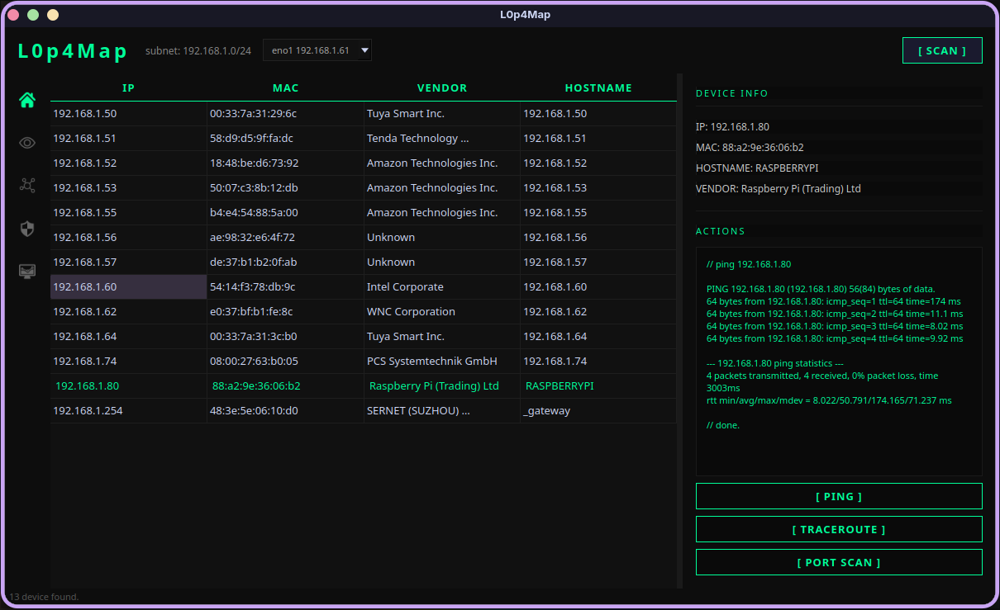
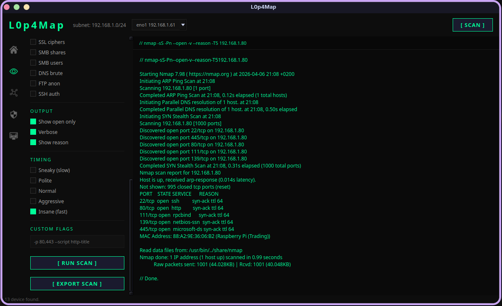
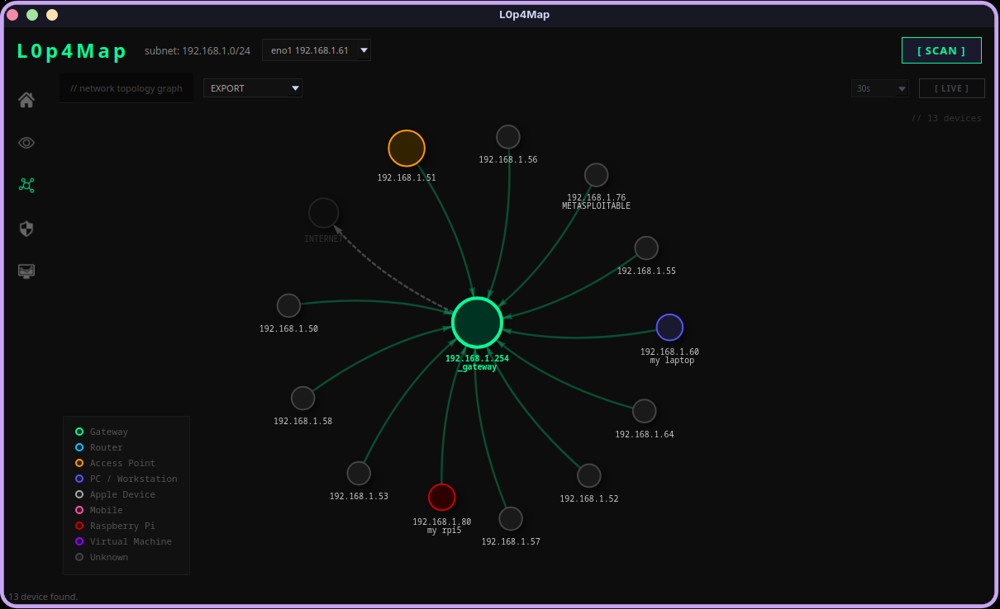
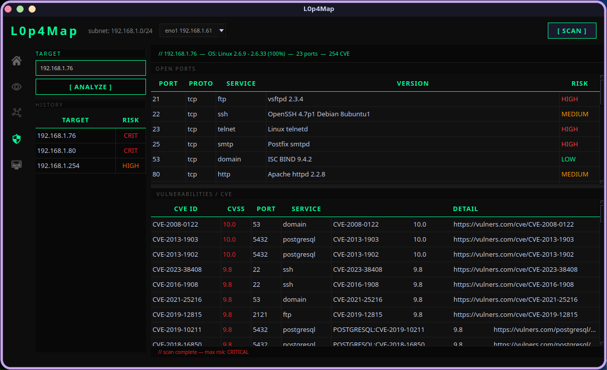
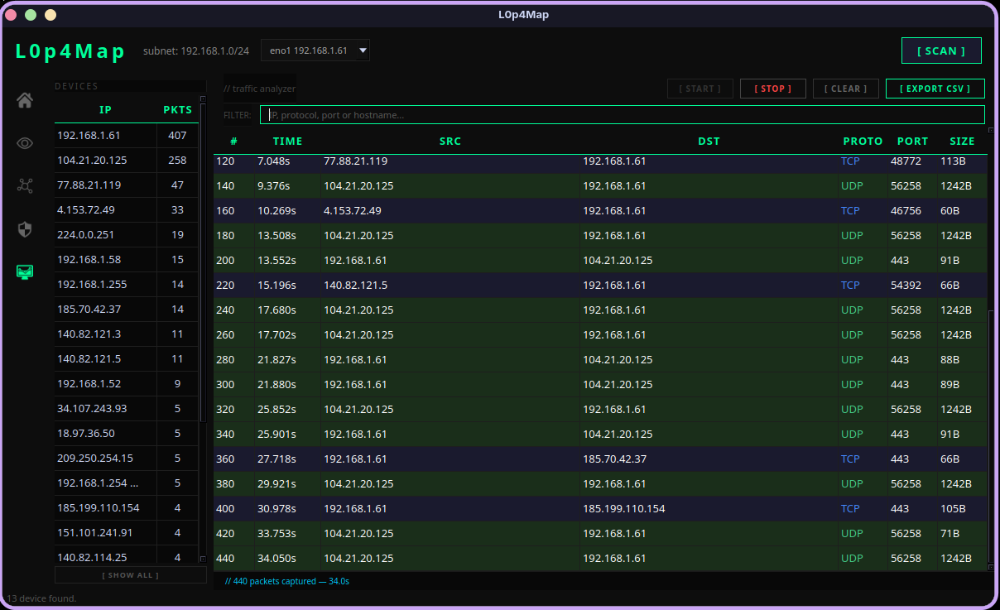

<div align="center">

# L0p4Map
**Nmap was blind. L0p4Map sees.**


Professional network monitoring & visualization tool built for security researchers.

https://github.com/user-attachments/assets/5ad0a1c3-e7fb-424c-94fd-b10bd3e2ffb3

</div>

---

## What is L0p4Map? 👁️

L0p4Map is a professional-grade network monitoring tool that combines the power of nmap with a clean, modern dark UI. Designed for security researchers and network administrators who need fast, detailed visibility into their infrastructure.

No bloat. No BS. Just raw network intelligence.

---

## Features

- **ARP Network Scan** — fast host discovery with local IEEE OUI database lookup
- **Hostname Resolution** — multi-method detection via reverse DNS, NetBIOS (Windows devices) and mDNS/Avahi (Linux, Mac, IoT)
- **Full nmap Integration** — SYN scan, UDP, OS detection, service version, NSE scripts
- **Banner Grabbing** — HTTP, SMB, FTP, SSH, SSL enumeration
- **Vulnerability Detection** — CVE lookup via vulners, vuln scripts, malware detection
- **Traceroute** — ICMP-based with real-time output
- **Dark Professional UI** — built with PyQt6, designed for researchers
- **Network Graph** — interactive topology visualization via vis.js
- **Interface Selection** — choose which network interface to scan on
- **Scan Export** — save full nmap output to `.txt` via native file manager dialog
- **Graph Export** — export the network topology as CSV or PNG
- **Live Monitoring** — auto-refresh the network graph at configurable intervals (30s / 60s / 120s)
- **Attack Surface section** — visualize exposed services, open ports, and potential vulnerabilities on hosts, helping identify security risks at a glance. (*in development*)
- **Traffic Analyzer page** — real-time network traffic inspection and analysis (*In Development*)
- **Custom Node Labels** — assign custom names to devices directly from the graph
- **Attack surface Result Download** — save full output to `.csv` via native file manager dialog *(`.pdf` soon!)*

## Inventory, alerts and reports

- **Persistent inventory (SQLite)** — every scan lands in `~/.l0p4map/inventory.db`: first/last seen, open ports, labels, groups and notes survive restarts.
- **Scan diff** — the app reports what changed since the previous scan: new devices, devices that disappeared, IP moves and newly opened ports.
- **Alerts** — desktop notification, Telegram bot, generic webhook (Slack / Discord / n8n) or SMTP email when something changes.
- **Scheduled scans** — every N minutes or daily at HH:MM, configurable from the toolbar menu or the CLI.
- **Device labels and groups** — right-click a device to name it, assign a group and keep notes; the label follows the device by MAC.
- **Client report** — one click produces a PDF (or HTML) with the inventory, exposure findings and CVE list.
- **Headless CLI** — `./l0p4map.py scan|inventory|label|events|schedule|report`, JSON output, no Qt needed (usable from cron or SSH).

## 🚧 Upcoming Features

- **CVE Links opening** — fix opening of CVE links
- **Graph Persistence** — save and reload network topologies

---

## Screenshots

### Home — Network Scanner


### Port Scan — Full nmap Integration


### Network Topology — Interactive network topology graph


### Attack surface - Exposed services, open ports and vulnerability overview *(in development)*


### Traffic Analyzer — Real-time network traffic analysis


---

## Requirements

- Linux (Debian or Arch) or macOS
- Python 3.11+
- nmap installed (`sudo pacman -S nmap`, `sudo apt install nmap` or `brew install nmap`)
- Root or `CAP_NET_RAW` for ARP discovery and packet capture — everything else (nmap scans, reports, CLI inventory) runs unprivileged

---

## Installation

### Quick Start (Recommended)
```bash
git clone https://github.com/Yattara78/L0p4Map.git
cd L0p4Map
python3 -m venv .venv
source .venv/bin/activate
pip install -r requirements.txt
python ui/app.py
```

---

## Usage

Launch the tool with root privileges:
```bash
sudo ./L0p4Map.sh
```

1. Select the network interface from the toolbar dropdown
2. Press **[ SCAN ]** to discover all devices on your network
3. Click a device to see details and run quick actions (ping, traceroute)
4. Press **[ PORT SCAN ]** to open the full nmap scan interface
5. Select scan options and press **[ RUN SCAN ]** — export results with **[ EXPORT SCAN ]**
6. Switch to the graph view to explore the network topology — export as CSV or PNG
7. Enable **[ LIVE ]** to keep the graph updated automatically
8. Right-click a device to label it, then use the **⋯** menu for the PDF report, the inventory CSV, alerts and scheduling

### Command line

No Qt, no GUI — useful from cron, a jump host or a mini-PC:

```bash
./l0p4map.py scan --json                     # ARP scan + inventory update
./l0p4map.py inventory                       # known devices
./l0p4map.py label aa:bb:cc:00:00:01 --label "NAS" --group "Serveurs"
./l0p4map.py events --limit 20               # new devices, new ports, IP moves
./l0p4map.py schedule --every 60             # every hour
./l0p4map.py schedule --daily 08:00
./l0p4map.py report --format pdf --out audit.pdf --subnet 192.168.1.0/24
```

Alerts and schedule live in `~/.l0p4map/config.json` (mode 600); the inventory is
`~/.l0p4map/inventory.db`. Both are shared by the GUI and the CLI. Override with
`L0P4MAP_DB` / `L0P4MAP_CONFIG_DIR`.

---

## Legal Disclaimer

This tool is designed for **authorized network auditing only**. Only use L0p4Map on networks you own or have explicit permission to test. Unauthorized scanning is illegal.

---

## Author

**HaxL0p4** — [GitHub](https://github.com/HaxL0p4)

---

<div align="center">
<sub>🚧 Under active development — star the repo to follow updates</sub>
</div>
